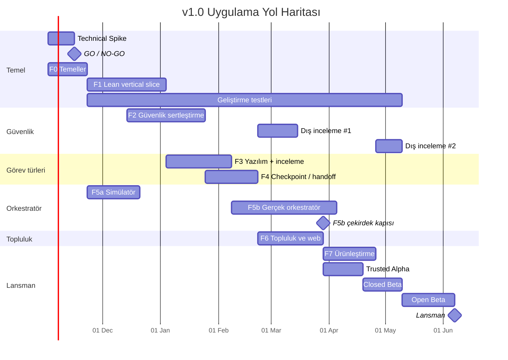

# implementation_roadmap.md

> **Kaynak:** PROJECT_SPEC1.2.md v1.2 (revize)
> **Hedef:** v1.0 — MVP'nin ötesinde tamamlanmış ürün olarak açık lansman
> **Tahmini süre:** ~32 hafta (≈ 8 ay)
> **Revizyon:** 1.3 — Güncellendi: kimlik izolasyonu ve sağlayıcı kapısı, görev/strateji sözleşmeleri, güvenli ayrıştırma, kullanıcı ve altyapı bütçeleri, gerçek görev benchmark'ları ve aday yaşam döngüsü
> **Uygulama takibi:** Güncel durum ve testler `docs/DEVELOPMENT.md`, CLI kabulü `docs/GO_GATE.md`, tarihli kararlar ADR'lerde tutulur. Bu belge planlanan fazları ve çıkış kriterlerini tanımlar.

---

## 1. Varsayımlar

Süre tahminleri aşağıdaki ekip varsayımına göredir. Ekip küçülürse paralel yürüyen fazlar sıralı hale gelir ve süre uzar.

**Ürün hedefi:** Spec §2.1'deki tamamlanmış v1.0 kapsamı korunur: üç masaüstü platformu, iki ajan, Lean ve yazılım görevleri, IDE benzeri çalışma alanı, dinamik orkestratör, checkpoint/handoff, inceleme, topluluk ve web. Uçtan uca ara sürümler ve alfa/beta aşamaları geliştirme ve sürüm doğrulama adımlarıdır. Test bulguları tasarımı, fazların sırasını ve takvimi değiştirebilir; kapsam değişikliği gerekçesiyle birlikte iki belgeye işlenir.

| Rol | Kişi | Ana sorumluluk |
|---|---|---|
| Backend | 2 | Koordinatör, orkestratör, API, veri modeli |
| Masaüstü / Rust | 1 | Tauri uygulaması, sandbox, ajan adaptörleri |
| Frontend | 1 | Masaüstü arayüzü, web sitesi, proje sahibi paneli |
| Altyapı + Lean | 1 | Doğrulayıcılar, Kubernetes, CI/CD, Mathlib önbelleği |
| Ürün / topluluk (yarı zamanlı) | 1 | Lansman projeleri, alfa/beta kullanıcıları, moderatörler |

**Diğer varsayımlar:**
- Spec'teki açık sorulardan teknik olanlar Faz 0'da kararlaştırılır (§3.3).
- Orkestratör simülatörü, gerçek backend'e ihtiyaç duymadığı için Faz 1 ile paralel olarak bir backend geliştiricisi tarafından yürütülür.
- Dış güvenlik incelemeleri bağımsız bir firma tarafından yapılır; inceleme süresince geliştirme durmaz.
- Lansman projeleri ve gerçek görev benchmark kümesi Faz 0'dan itibaren hazırlanır; Lean hedeflerinin doğru formalizasyonu ve görevlerin bağımsız doğrulanabilirliği kontrol edilir.
- Haftalar takvim haftasıdır; her fazda ~%15 gecikme payı vardır. ~32 hafta ekip/uyumluluk varsayımlarına bağlı planlama tahminidir. REWORK, kapı başarısızlığı veya yeni test bulgusu kritik yolu etkilerse tablo ve Gantt birlikte güncellenir; bitmiş ürün kabul kriterleri takvime yetişmek için atlanmaz.

---

## 2. Genel Bakış

| Faz | Ad | Hafta | Bağımlılık |
|---|---|---|---|
| 0 | Technical Spike + Temeller | 1–3 | — |
| — | **GO / NO-GO kapısı** | 2 sonu | Spike |
| 1 | Lean vertical slice (uçtan uca) | 4–9 | GO veya GO WITH LIMITATION |
| — | Geliştirme doğrulaması ve gerçek görev benchmark'ları | 4–27 | İlgili özellik hazır; gerçek hesap testleri için kimlik izolasyonu kapısı |
| 5a | Orkestratör simülatörü | 4–7 | F0 (şemalar) |
| 2 | Güvenlik sertleştirme | 7–12 | F1 (kısmi) |
| 3 | Yazılım görevleri, milestone'lar ve inceleme | 10–14 | F1 |
| 4 | Checkpoint ve handoff | 13–16 | F1, F3 milestone/inceleme çekirdeği (kısmi) |
| — | **Dış güvenlik incelemesi #1** | 17–19 | F2, F4 |
| 5b | Gerçek orkestratör | 15–22 | F3 (milestone'lar), F5a |
| 6 | Topluluk, puan ve web sitesi | 17–21 | F3, F4 |
| 7 | Ürünleştirme | 22–25 | F2–F4, F6, F5b çekirdek kapısı |
| 8a | Trusted Alpha (10–20 kullanıcı) | 22–24 | İnceleme #1 bulguları kapatıldı; F5b çekirdek kapısı (Hafta 21 sonu) |
| 8b | Closed Beta (50–100 kullanıcı) | 25–27 | Alfa |
| — | **Dış güvenlik incelemesi #2** | 26–27 | F7 sürüm adayı |
| 8c | Open Beta | 28–31 | Kapalı beta, inceleme #2 |
| 8d | Lansman | 32 | Tümü |

**Mantıksal akış:**
```text
F0  Technical Spike + Temeller
 ↓
GO / NO-GO kapısı
 ↓
F1  Lean Vertical Slice ──────→ F5a Orkestratör Simülatörü (paralel)
 ↓
F2  Güvenlik Sertleştirme
 ↓
F3  Yazılım + Milestone'lar + İnceleme
 ↓
F4  Checkpoint / Handoff
 ↓
Dış Güvenlik İncelemesi #1
 ↓
F5b Dinamik Orkestratör
 ↓
F6  Topluluk + Web
 ↓
Trusted Alpha ──────→ F7 Ürünleştirme (paralel)
 ↓
Closed Beta + Dış Güvenlik İncelemesi #2
 ↓
Open Beta
 ↓
Lansman
```
> Akış mantıksal sırayı gösterir; tablodaki haftalarda görüldüğü gibi fazların çoğu kısmen paralel yürür.



> Tarihler örnek başlangıca (2 Kasım 2026) göredir; gerçek başlangıca göre kaydırılır.

**Kritik yol:** Spike → GO kapısı → F1 → F3 (milestone'lar) → F5b → Trusted Alpha → Closed Beta → Open Beta → Lansman. Dış inceleme #1'in bulguları Trusted Alpha'dan önce kapatılmak zorunda olduğu için o da kritik yola bağlanır.

F5b'nin çekirdek kabul kriterleri Hafta 21 sonunda karşılanırsa F7 ve Trusted Alpha Hafta 22'de başlayabilir; F5b'nin son haftası güvenlik/kabul davranışını değiştirmeyen sertleştirme ve hata düzeltmelerine ayrılır. Çekirdek kapı geçilmezse bağlı fazlar kaydırılır. Geliştirme testleri ilgili fazlara paralel yürür; sonuçlar yeni kapsam daraltma varsayımı olmadan uygulama kararlarını besler.

---

## 3. Faz 0 — Technical Spike ve Temeller (Hafta 1–3)

### 3.1 Technical Spike — Ajan + Sandbox Fizibilitesi (Hafta 1–2)
Projenin en büyük teknik bağımlılığı, kullanıcının mevcut Claude Code / Codex CLI oturumunun izole bir sandbox içinde güvenli bir çalışana dönüştürülebilmesidir. Ana implementasyondan önce bu soru cevaplanır.

2026-10-08 ilk kanıt: Windows host + Docker Linux/WSL2 üzerinde 12 task-tools saldırı/yaşam döngüsü kontrolü; resmi Claude 2.1.293 ve Codex 0.157.1 Linux binary'leriyle strict MCP/dynamic task tool üzerinden 20 fixture kontrolü ve owned cleanup geçti. Ayrı native Windows denemesinde Claude.ai Pro ve ChatGPT oturumuyla araçsız gerçek model yanıtı alındı. CLI/task fixture sahte auth ve yerel model yanıtı kullanır; native bağlantı OS kimlik izolasyonu sayılmaz. Sonraki gerçek izole görev kanıtı aşağıda, kayıtlar ADR 0004/0005/0006 ve `spike/results` içindedir; tam F0 kabulü/GO henüz tamamlanmadı.

Sonraki F0 adımı uygulandı: private resmi auth hacmi, readonly doğrulanmış CLI cache'i ve network-none CLI'dan stdio exact-provider egress. İki sağlayıcının canary/TLS/broker/budget/restart/concurrent-command sınırı 16 kontrol geçti; deterministik verifier hattı 8 kontrol geçti. Kullanıcı iki yeni resmi girişi tamamladı. Claude Sonnet 4.6 ve Codex `gpt-6-astra` dar profili gerçek görevde kod değiştirdi; iki aday ayrı readonly verifier'da 32'şer örnek ve `git apply --check` geçti. Codex public profilinin wire envanteri ayrıca 10 kontrolle doğrulandı. Codex resmi managed refresh isteği ve iki izole profile logout geçti; token içeriği/rotation ölçülmedi. Windows auth dosyaları taşınmadı. CA/TLS incelemesi ve model profili bulguları ADR 0006'da, tekrar koşulları `spike/cli-session/MANAGED_SESSIONS.md` içinde. Claude doğal expiry/refresh/relogin, geniş adversarial yollar, kota/eşzamanlılık, genel artifact güvenliği ve diğer hostlar bekler. F1 GO kapısı ve tamamlanmış v1 kapsamı korunur.

Bir sonraki güvenlik artışı ADR 0007'de kaydedildi: eski oturumlar kullanılmadan yeni sentetik profillerde görev dosya/process/fd/env/socket/ptrace, PID/tmpfs tükenmesi, proxy/broker ve deadline/çıktı teardown paketi; DNS/connection admission, backpressure ve sticky failure; resmi session lifecycle ve dar `sum.mjs` artifact policy/gerçek Git apply/hash eşitliği. Pure regression testleri genel kontrol komutuna, hesapsız Docker testleri Ubuntu CI'a eklendi. Uzak CI veya gerçek auth/inference güncel kodla tekrar kabul edilmiş sayılmaz. Genel repository/paket importer ve production secret scanner, Claude doğal yenilemesi, gerçek kota/eşzamanlılık, tüm provider extension yolları ve diğer hostlar kalan iştir; GO kapısı değiştirilmedi.

Oturum sürekliliği ve işlem sahipliği ADR 0008'de geliştirilir: doğrulanmış immutable Docker ID ile komut/kontrol gönderimi, eski işlem temizliğinin successor'ı koruması, durmuş tam işlem uzlaştırması ve timeout/iptal sonrası alt süreç teardown. Salt okunur resmi oturum kabulü import-safe yardımcılar, profile bağlı public checkpoint ve sayısal Codex kota snapshot'ıyla ayrı geliştirici komutudur; doğal expiry/renewal veya gerçek kota tükenmesi kabulü sayılmaz. Yerel sonuçlar `docs/DEVELOPMENT.md` ve `spike/results` içindedir. Ürün ticari olarak düşünülür; kullanıcı mevcut resmi CLI + kendi aboneliği tasarımında teknik geliştirmeye devam etmeyi seçti. API/yerel model pivot yapılmadı; sağlayıcı incelemesi `docs/PROVIDER_COMPATIBILITY.md` içinde kayıtlıdır. v1 kapsamı ve production GO kapısı korunur.

**Test edilecekler (her iki CLI için):**
- Kullanıcının mevcut oturumuyla, test repository'si üzerinde, sandbox içinde headless çalıştırma.
- Ajanın çalışma alanında dosya okuyup değiştirebilmesi, komut çalıştırabilmesi ve geçerli bir git diff üretebilmesi.
- İki kimlik modeli; aynı güvenlik kriterleriyle:
  - **A — İzole CLI çalışma zamanı:** Resmi CLI/auth, görev araç süreçlerinden ayrı kimlik ve dosya/süreç yetkileriyle çalışır. Kimlik konumu yalnızca CLI'a açılır; görev sandbox'ına bağlanmaz. Salt okunur mount tek başına izolasyon sayılmaz. Resmi CLI'ın dosya ve komut araçları yalnızca görev sandbox'ına ulaşmalıdır.
  - **B — Host-side broker:** CLI host'ta çalışır; tüm görev dosya/komut işlemleri sandbox'tadır. CLI sürecinin kendisi OS-level izinlerle kişisel dosya, tarayıcı verisi ve SSH anahtarlarından ayrılır. Resmi CLI/auth'a gerekli dar erişim verilir; görev süreçleri bu erişimi devralamaz.
- Kötü niyetli görev kodundan doğrudan kimlik dosyası okuma, CLI dosya aracını kötüye kullanma, ortam değişkeni, süreç belleği/ptrace ve `/proc` üzerinden erişim denemeleri. Host dosyalarına erişim, Docker/Podman soketi ve açık dosya tanıtıcıları da kontrol edilir. Başarılı model çağrısı ile bu saldırıların engellenmesi birlikte kanıtlanmalıdır.
- Token yenilemesi, oturum sonlandırma/sona erme, yeniden giriş ve eşzamanlı denemelerin auth davranışı; salt okunur cache kullanan tasarımda yenileme ayrıca test edilir.
- Sağlayıcı uyumluluğu: resmi binary değiştirilmeden çalıştırma, kullanıcının resmi giriş akışı, abonelik otomasyonu ve ürün içinde dağıtım koşulları incelenir (spec §19). Desteklenmeyen OAuth/token yönlendirmesi çözüm olarak kullanılmaz. Kanıtlar CLI sürümü ve platform bazında uyumluluk matrisine eklenir; lansmana bırakılmaz.
- Resmi entegrasyon protokolleri ve varsa resmi yerel yetkilendirme seçenekleri değerlendirilir. Spec §6.3'ü değiştiren bir seçenek seçilirse güvenlik sözleşmesi ve testleri uygulanmadan entegrasyon yapılmaz.
- Kimlik bilgisinin platform sunucusuna gitmediğinin doğrulanması: süreç bazında ağ hedefleri, güvenilir istemcinin yüklediği paketler ve redakte edilmiş loglar kontrol edilir. Yalnızca ağ hedefi allowlist'i veya secret scanning bu güvence için yeterli sayılmaz.
- Ağ allowlist'i altında CLI'ın çalışmaya devam etmesi: yalnızca belgelenmiş provider endpointleri, koordinatör ve task bazında açıkça izin verilen Git/package registry endpointleri erişilebilir olmalıdır; diğer rastgele outbound trafik kapalı kalır.
- İptal, zaman aşımı, oturum süresinin dolması ve kullanım limitine ulaşılması durumlarının algılanabilmesi.
- Headless çıktının adaptör tarafından güvenilir şekilde ayrıştırılabilmesi; model/reasoning/sürüm ve kullanım metadata'sının desteklendiğinde alınması, desteklenmediğinde `unknown` olması.
- Abonelik kotası dolunca ücretli API moduna otomatik geçilmediği ve yerel süre/eşzamanlılık sınırlarının uygulanabildiği.

**Çıkış kriteri:** Claude Code ve Codex CLI'ın her biri referans platformda test edilir; üç platform için destek/eksik matrisi çıkarılır. En az bir ajanla gerçek kodlama görevi tamamlanır, geçerli diff alınır ve yukarıdaki kimlik erişim/yenileme testleri geçer. Sonuçlar, sağlayıcı kaynakları ve eksikler ADR'ye yazılır. **GO veya GO WITH LIMITATION olmadan F1'e geçilmez.** REWORK sırasında bağımsız temel işler devam edebilir; bağımlı entegrasyon işleri yeniden geçen kapıyı bekler.

### 3.2 GO / NO-GO Kapısı (Hafta 2 sonu)

| Karar | Koşul | Sonuç |
|---|---|---|
| **GO** | İki ajan da referans platformda seçilen A/B modeliyle kimlik izolasyonu, token yenileme ve sağlayıcı koşullarını karşılıyor | F1 ilk production adaptörüyle başlar; ikinci adaptör F3'te tamamlanır |
| **GO WITH LIMITATION** | Yalnızca bir ajan referans platformda aynı koşulları karşılıyor; ikinci ajan/platform eksikleri ve çözüm işleri kayıtlı | F1 başarılı ajanla başlar. İkinci ajan v1.0 hedefinde kalır; F3 ve lansman kapıları için tekrar test edilir. Çözülemeyen destek sorunu belgelenmiş kapsam/takvim revizyonu gerektirir |
| **REWORK** | Test edilen tasarım güvenlik veya auth sürdürülebilirliği koşullarını karşılamıyor; alternatif A/B tasarımı araştırılabilir | Referans tasarım değiştirilir, saldırı/yenileme testleri yeniden çalıştırılır. Planlama için 2–3 hafta ek süre ayrılır; F1 öncesinde yeniden GO/GO WITH LIMITATION gerekir. Yalnızca araç çağrısını yönlendiren veya okunabilir kimlik mount'u kullanan tasarım kabul edilmez |
| **NO-GO** | Hiçbir desteklenen ajan güvenli ve sağlayıcı tarafından desteklenebilir bir entegrasyonla çalışmıyor | Mimari yeniden tasarlanır (örn. API anahtarı tabanlı katılım veya yerel model desteğinin öne çekilmesi). Yol haritası yeniden yazılır. |

Kapı kararını tüm ekip verir; kararın gerekçesi ve kanıtları ADR'ye eklenir. Ajan/platform desteğinin ara fazlarda kısmi olması, bitmiş v1.0 kapsamının kendiliğinden daraltılması anlamına gelmez.

### 3.3 Temeller (Hafta 1–3)
Spike'tan bağımsız, her senaryoda gerekecek işler paralel yürür:
- Monorepo kurulumu:
  ```text
  /apps/desktop           Tauri + React
  /apps/web               Next.js web sitesi
  /services/coordinator
  /services/orchestrator
  /services/verifier
  /packages/task-schema   Görev/checkpoint JSON şemaları + doğrulayıcı
  /packages/agent-adapters
  /infra                  Kubernetes, Terraform, imaj tanımları
  /sim                    Orkestratör simülatörü
  /spike                  Technical Spike kodu ve ADR'ler
  ```
- CI: lint, test, şema doğrulama; masaüstü için üç platformda derleme.
- **Teknik kararlar (spec §18'den):** koordinatör dili (öneri: Go — uzun süreli, eşzamanlı bağlantılar ve düşük kaynak kullanımı için), barındırma sağlayıcısı, nesne depolama.
- Görev şeması v1 (`packages/task-schema`): JSON Schema + her iki dil için üretilmiş tipler. `type`/`kind`, doğrulama profilleri, planlayıcı çıktı şeması, `task_version`/`contract_hash`, onaylı stratejiler ve denemeye özel `execution_context` sözleşmesi dahil. Simülatör aynı şemayı kullanır.
- Veri modeli v1, migration altyapısı; PostgreSQL kiralama/bütçe/outbox, gönderim/checkpoint/inceleme/tek kazanan, gerçek DB kabulü ve sonradan verifier/puan/merge/workflow bağlantısı.
- OAuth girişi (GitHub, Google): kalıcı provider subject, browser-bound state/PKCE/OIDC, opaque session, hesap/katkı ekranı; gerçek provider/staging ve paketlenmiş native auth dönüşü kabulü.
- Staging ortamı.
- Referans Lean görevleri, benchmark metodolojisi ve ayarlama/değerlendirme kümelerinin ayrılması; lansman projelerinin hazırlanması.
- Kullanıcı katkı bütçesi varsayılanları, platform doğrulama/depolama maliyet modeli ve kotalar (spec §6.9, §15).
- Temporal Go SDK için ayrı F0 modülü: kalıcı history ile worker + sunucu kesintisi sonrası devam; retry/idempotency, eski olay, deadline ve iptal testleri. Production entegrasyonu F1'de outbox ve PostgreSQL domain kayıtlarıyla yapılır.
- SWE-ReX sabit commit'i ve resmi CLI sürümleriyle araç yönlendirme araştırması; önce kimliksiz test ortamı. Varsayılan Docker port/ağ ayarları güvenlik sözleşmesi olarak kabul edilmez. Runtime motoru olmayan cihazda sonuç `not_evaluated` kalır.
- Açık kaynak/lisans envanteri: Cosign, Trivy, OpenTelemetry, Monaco, xterm.js, React Flow; git2-rs/libgit2, OPA ve Semgrep koşulları. Ayrıntılı seçim: `docs/OPEN_SOURCE_SELECTION.md`.

**Faz 0 çıkış kriteri:** GO veya GO WITH LIMITATION; boş masaüstü uygulaması staging koordinatörüne giriş yapıp boş görev listesini çekebiliyor. Uyumluluk matrisi, tehdit modeli, görev/planlayıcı şemaları ve ilk merkezi maliyet hesabı kayıtlı.

Temporal denemesinin geçmesi CLI izolasyonu kapısını geçirmez. Temporal için development-server recovery kanıtı ile staging işletim/retention/maliyet kabulü ayrı kaydedilir. Bu seçimler tamamlanmış v1 kapsamını azaltmaz; yeniden yazılacak altyapıyı değiştirir.

---

## 4. Faz 1 — Lean Vertical Slice (Hafta 4–9)

**Amaç:** Tek bir Lean görevinin uçtan uca çözülmesi: listele → kirala → sandbox → ajan → gönder → doğrula.

**Masaüstü:**
- Docker/Podman algılama ve sandbox yaşam döngüsü (spike'ta seçilen kimlik modeliyle).
- `AgentAdapter` arayüzü ve **spike'ta başarılı olan ilk ajanın production adaptörü** (Claude Code veya Codex CLI). İkinci adaptör F3'te tamamlanır; ortak arayüzün uyumluluğu iki CLI'ın sözleşme testleriyle izlenir.
- Görev listesi, görev detayı ve çalışma ekranının ilk sürümleri.
- Monaco kod/diff editörü ve xterm.js sandbox terminali; Tauri CSP/worker uyumu, dosya erişimi ve yalnız görev PTY'sine bağlantı. git2-rs ihtiyaç duyulan clone/tree/diff işlemleriyle test edilir.
- Yerel ön kontrol (`local_precheck`) ve sonuç paketi oluşturma.
- Tek deneme/günlük süre ve eşzamanlılık sınırları; kullanım hataları ve ücretli moda otomatik geçişin engellenmesi. Kullanıcıya başlangıçta etkin limitlerin gösterilmesi.

**Koordinatör:**
- Görev CRUD, kiralama, heartbeat, zaman aşımı.
- Sonuç yükleme (S3), Temporal deneme/doğrulama workflow'u ve Kubernetes Job çalıştırıcısı.
- PostgreSQL transaction outbox'ı, sabit olay/iş kimliği, deduplication ve uzlaştırma; Temporal teslimat/retry ile çift puan veya çift doğrulama maliyetinin önlenmesi.
- OpenTelemetry: API → workflow → doğrulayıcı izleri; ham prompt/token/ajan logu içermeyen metadata. Temporal retention/replay, yedekleme ve staging maliyet kabulü.
- Görev sürümü/hash'e bağlı kiralama, idempotent gönderim, eski kiralamanın durum değiştirmesini engelleme; atomik süre rezervasyonu ve doğrulama kotaları.

**Doğrulayıcı:**
- `lean-mathlib` imajı ve önceden derlenmiş Mathlib önbelleği.
- İlk imajdan itibaren Cosign ile digest ve beklenen signer/issuer veya anahtar doğrulaması; Trivy imaj/bağımlılık taraması.
- §9.1 genel akış: format kontrolü, `writable_paths`, `forbidden_patterns`, temiz konteynerde derleme.
- §9.2 Lean kontrolleri: transitif axiom denetimi, değiştirilemeyen challenge/tanım ortamı, elaborated hedef karşılaştırması ve adayın etkileyemediği ispat kontrolü. Doğrulayıcının kendi servis kimliklerinden/ağından izolasyonu bu fazda kurulur (spec §12.4).

**Çıkış kriteri:** Elle yüklenmiş 20 Lean görevinden oluşan test projesinde, ekip üyeleri ilk başarılı gerçek ajanla görevleri çözüp doğrulatabiliyor. Tanımlı hile paketi (`sorry` bağımlılığı, teorem/tanım değiştirme, yasak aksiyom, sahte checker çıktısı) tamamen reddediliyor. Yerel katkı sınırları ve maliyet/kuyruk ölçümü çalışıyor; ilk gerçek görev benchmark raporu üretilmiş.

### 4.1 Sürekli Geliştirme Doğrulaması (F1'den itibaren)
- İlk Lean akışı hazır olunca aynı görev ve toplam süre bütçesiyle tek ajan ile basit paralel denemeler karşılaştırılır. Onaylı farklı stratejiler elle atanarak yönlendirilmiş denemeler ölçülür; F5b hazır olduğunda aynı harness gerçek orkestratörü de karşılaştırmaya alır.
- Model/profil, benzer hatalar, token/kullanım metadata'sının kaynağı, duvar saati, doğrulanmış başarı ve merkezi doğrulama maliyeti raporlanır. Tek başarılı deneme genelleştirilmez; tekrar sayısı ve belirsizlik raporda görünür.
- Temiz makine kurulum, görev başlatma ve durdurma akışları üç platformda test edilir; IDE çalışma alanı, milestone, inceleme ve handoff tamamlandıkça senaryolar genişler. Gerçek hesaplar yalnızca o ajan/platformun kimlik izolasyonu kapısı geçtikten sonra kullanılır; erken testlerde kontrollü görevler kullanılır.
- Her faz sonunda bulgu → karar → değişiklik → yeniden test kaydı tutulur. Güvenlik veya verimlilik sorunu ilgili tasarımı/politikayı düzeltir; kritik yol değişirse tablo ve Gantt yenilenir. Nihai ürün kapsamı spec ile birlikte yönetilir.

---

## 5. Faz 2 — Güvenlik Sertleştirme (Hafta 7–12)

**Amaç:** Spec §6.3, §6.4 ve §12'nin tamamı. F1 ile paralel başlar; F1'in sandbox'ını sertleştirir.

**İşler:**
- Linux'ta gVisor (`runsc`) ve sanallaştırma destekleyen sunucuda Kata: aynı Lean/yazılım görevleriyle uyumluluk, CPU/RAM/I/O, iptal ve saldırı benchmark'ı. Seçilen runtime platform bazında belgelenir; Windows/macOS Linux VM bağımlılığı ve gönüllü kurulum maliyeti ayrıca ölçülür.
- Süreç bazında ağ politikası: model erişimi resmi CLI/auth katmanında, koordinatör erişimi istemcide; görev kodunda varsayılan kapalı ağ ve görev bazında onaylı registry izinleri (spec §6.4).
- Salt okunur kök dosya sistemi, yetkisiz kullanıcı, kaynak sınırları.
- Kimlik bilgisi politikası (§6.3), spike'ta seçilen modele göre.
- Kimlik dosyası, CLI dosya araçları, süreç/ortam okuma ve token yenileme saldırı testlerinin desteklenen platformlara genişletilmesi.
- İstemci ve sunucu tarafı **secret scanning**: Trivy ilk aday; Gitleaks yalnız ek fayda ölçülürse ikinci tarayıcı. Güvenli arşiv açma ve scanner izolasyonu.
- Cosign imza doğrulaması, imaj digest'ine bağlı tarama raporu ve güvenilen yayıncı politikası; geçerli herhangi bir imza yeterli değildir.
- OPA politika arayüzü ve sürümlü kurallar; deny kararı gerçekten runtime'da uygulanır. Kaynak sınırı ve kimlik izolasyonu politika motoruna bırakılmaz.
- Doğrulayıcı worker izolasyonu, cache/harness bütünlüğü ve paket/diff açma güvenliği (spec §12.4); kötü niyetli proje doğrulama komutlarıyla test.
- Görev moderasyon akışı (§12.2) ve görev prompt'larında şüpheli talimat taraması.
- **Kırmızı takım testi:** kötü niyetli görev setiyle (sandbox kaçışı, kimlik bilgisi okuma, ağ sızdırma, prompt injection) otomatik güvenlik test paketi. Bu paket CI'da kalıcı olarak çalışır.

**Çıkış kriteri:** Tanımlı kırmızı takım paketindeki tüm senaryolar engelleniyor; her desteklenen ajan/platform için kimlik izolasyonu ve yenileme kanıtları kayıtlı. Dış güvenlik incelemesi #1 için mimari belgeler ve tehdit modeli hazır (§11). Test paketinin geçmesi tüm olası saldırıların engellendiği iddiası olarak sunulmaz.

---

## 6. Faz 3 — Yazılım Görevleri, Milestone'lar ve İnceleme (Hafta 10–14)

Semgrep CE kendi veya ürün içinde kullanımı uygun lisanslı kurallarla yardımcı inceleme sinyali olarak değerlendirilir. Tarama test/milestone doğrulaması ve bakımcı incelemesinin yerine geçmez; motor, kural paketi ve ücretli özellikler ayrı envanterlenir.

**Amaç:** İkinci proje türü ve tüm platformun dayandığı ilerleme ölçüsü.

**İşler:**
- Dil imajları: `node`, `python`, `rust`, `go`.
- CI doğrulayıcıları: görünür + gizli test setleri, lint, diff boyutu sınırı (§9.3).
- Gizli test setlerinin proje sahibinden alınması ve güvenli saklanması.
- **Milestone sistemi (§11.2):** şemadaki `progress.milestones`, ağırlıklı test grupları, `critical` işareti, gerileme tespiti, sunucu tarafı ölçüm.
- Lean için iskelet boşluklarının milestone olarak tanımlanması.
- Lean milestone'larında transitif `sorryAx`/axiom denetimi; başka çözülmemiş boşluğa taşınan ispatın `blocked` olması (spec §11.2).
- **İnceleme ve birleştirme (§9.6):** sonuç durum makinesi, `auto` / `maintainer` / `community` politikaları, inceleme ekranı, otomatik rebase + yeniden doğrulama. Adayda güvenli durdurma/checkpoint, ret/değişiklik sonrası yeniden kiralama ve atomik tek kazanan kabulü; düğümün entegrasyon sonrası `solved` olması.
- **İkinci ajanın production adaptörü** (F1'de Claude Code seçildiyse Codex CLI; Codex CLI seçildiyse Claude Code). Her iki adaptörde sağlayıcı uyumluluğu ve kimlik testleri yeniden geçer.
- Kullanıcı katkı bütçesi ekranları, kotaya/oturum hatasına göre durdurma ve ayrı ücretli kullanım seçimi; sunucu kiralama ve doğrulama kotalarıyla uyum.

**Ara bağımlılık kapısı (Hafta 12 sonu):** Milestone ve inceleme veri/API sözleşmeleri F4'ün başlaması için hazır; aday güvenli durdurma davranışı checkpoint arayüzüyle sözleşme testinde doğrulanmış. Tam handoff testleri F4'te tamamlanır.

**Çıkış kriteri:** Gerçek bir açık kaynak depodan türetilmiş 10 yazılım görevi iki farklı ajanla çözülüp bakımcı incelemesinden geçerek birleştiriliyor. Milestone manipülasyonu, aday ret sonrası yeniden açılma, iki eşzamanlı kabul, rebase başarısızlığı, kullanım limiti ve otomatik ücretli geçiş senaryoları doğru işleniyor. İkinci ajan kapısı geçilmezse bağlı iki ajanlı testler ve takvim güncellenir; eksik destek tamamlanmış kabul edilmez.

---

## 7. Faz 4 — Checkpoint ve Handoff (Hafta 13–16)

**Amaç:** Spec §6.6 ve §9.5.

**İşler:**
- Soft ve hard checkpoint üretimi; periyodik, elle ve kurtarma checkpoint'leri.
- Continuation context oluşturma ve token üst sınırı.
- Checkpoint doğrulaması: format, yol, secret scanning, diff uygulanabilirliği, hızlı testler, Lean hedef/axiom bağımlılık denetimi + milestone ölçümü. Yeni boşluğun veya çözülmemiş bağımlılığın sahte ilerleme üretmemesi.
- Soft checkpoint metinlerinin "güvenilmeyen veri" olarak ajana verilmesi ve şüpheli talimat taraması (§12.3).
- `checkpoints` tablosu, `parent_checkpoint_id` zinciri, `expires_at` temizliği.
- Arayüz: **Checkpoint Kaydet**, **Durdur ve Devret**, devralma ekranı.
- Ajanlar arası handoff (Claude Code → Codex CLI ve tersi).
- Aday incelemesi için durdurulan denemelerin temiz sandbox ve yeni kiralamayla devamı; checkpoint kaydı başarısız olduğunda güvenli durdurma ve yerel kurtarma davranışı.

**Çıkış kriteri:** Bir yazılım görevi üç farklı gönüllü ve iki farklı ajan arasında devredilerek tamamlanıyor. Zararlı checkpoint test senaryoları reddediliyor.

---

## 8. Faz 5 — Orkestratör

Projenin en kritik ve en belirsiz bileşeni olduğu için iki alt faza bölünür ve simülatör çok erken başlar. Böylece gerçek orkestratöre gelindiğinde zamanlama algoritmaları aylardır simülatörde denenmiş olur.

### 8.1 F5a — Simülatör (Hafta 4–7, F1 ile paralel)
Gerçek backend veya gönüllü gerektirmez; Faz 0'daki görev şemasını kullanır.
- Sentetik arama ağaçları (AND/OR, farklı derinlik ve zorluk dağılımları, "yanlış lemma" dalları, tuzak dallar).
- Sentetik gönüllü ve ajan modelleri (farklı başarı oranları, süreler, ayrılma ve handoff olasılıkları).
- Aynı model/stratejide ilişkili başarısızlıklar, tekrar eden artifact'lar, sağlayıcı kota kesintileri ve doğrulama/inceleme kuyruğu baskısı.
- Sentetik milestone'lar ve gürültülü ilerleme sinyalleri.
- Taban politikalar: rastgele, round-robin, en az denenen önce; aynı bütçede tek ajan ve basit paralel denemeler için karşılaştırma modeli.
- §8.3'teki ölçütleri üreten raporlama.

Simülatör Hafta 7'den sonra da yaşayan bir araç olarak kalır: F5b'deki her politika değişikliği önce simülatörde regresyon testinden geçer.

### 8.2 F5b — Gerçek Orkestratör (Hafta 15–22)
- Arama ağacı veri modeli: `nodes`, düğüm durumları, AND/OR ilişkileri.
- Sinyal toplayıcı: sunucuda doğrulanmış milestone/sonuç, koordinatörün zamanlama bütçesi ve hata kayıtları; model/profil metadata'sının kaynağı belirtilen `agent_stats`. İstemcinin tüketim/ilerleme iddiası doğrulanmış compute sayılmaz.
- Olay tabanlı + periyodik karar döngüsü (simülatörde seçilen politika ve parametrelerle).
- **Compute dağıtımı:** Thompson sampling, `exploration_ratio`, dinamik paralellik (`initial`–`cap`).
- **Ajan çeşitlendirme:** model/reasoning/strateji profiline göre başarısızlık sonrası farklı profil önceliği, bağımsız modda çeşitlilik kuralı; küçük örneklemin belirsizliği.
- **Görev üretimi:** `plan`, `refute`, `rebase` çıktı sözleşmeleri ve immutable görev hash'i; onaylı strateji seçimi `execution_context` içinde. Planlayıcı mevcut prompt/test/izin sözleşmesini değiştiremez.
- **Lean ayrıştırması:** Alt hedefleri açık hipotez olarak alan `sorryAx` içermeyen bağlantı ispatı, sabit hedef/tanımlar, DAG ve bütçe kontrolleri. `False`, aynı hedefi tekrar etme ve döngü saldırıları reddedilir. Genel öneriler önce gözlem/insan incelemesinde; otomatik kabul yalnızca önceden onaylı şablonların kontrolleriyle.
- Yazılım üst hedefinin entegrasyon doğrulaması; alt görevlerin geçmesiyle erken `solved` durumuna geçilmemesi.
- **Dal kapatma:** bütçe tükenmesi, çürütme, kardeş çözüldü, üst hedef çözüldü; arşivleme ve yeniden açma.
- Bağımsız modda aday bulunduğunda yeni kiralamaları durdurma, güvenli checkpoint isteği ve inceleme durumları; kabul edilen kazanan sonrası kalıcı iptal, ret sonrası kullanıcı onayıyla devam.
- Bütçe ve politika API'si, hazır politika şablonları (§10.5).
- Karar günlüğü (`orchestrator_decisions`) ve insan müdahalesi (`/nodes/{id}/override`).
- Proje detayında React Flow ile arama ağacı görselleştirmesi; sunucu karar/state verisi gösterilir, görsel işlem yetki kontrolünü atlayamaz.
- Politikayı önce gözlem modunda çalıştırma, gerçek görev benchmark harness'ine bağlama ve başarısız politika güncellemesinde önceki sürüme dönüş. Seed, politika sürümü ve girdilerle karar tekrar üretimi.

### 8.3 Değerlendirme Ölçütleri
Yalnızca maliyete bakmak yanıltıcıdır: çok agresif dal kapatan bir sistem ucuz görünür ama zor problemlerde başarı oranı düşer. Bu nedenle orkestratör taban politikalarla şu ölçütlerin tamamında karşılaştırılır:

| Ölçüt | Açıklama |
|---|---|
| Başarı oranı | Bütçe içinde çözülen problemlerin oranı |
| Ajan-saati / çözülen problem | Zamanlama kapasitesi verimliliği; gerçek token/model tüketiminin kanıtı değildir |
| Duvar saati süresi | Problemin başlangıcından çözümüne geçen gerçek süre |
| Başarısız deneme oranı | Doğrulamayı geçemeyen denemelerin oranı |
| Erken kapatma oranı | Kapatıldıktan sonra çözüme giden yolun o dalda olduğu anlaşılan dalların oranı |
| Benzersiz yararlı dal sayısı | Final çözüme katkı veren, doğrulanmış bir çürütme üreten veya başka dallarda yeniden kullanılan lemma/bileşen üreten dallar |
| Korelasyon ve tekrar | Aynı profil/stratejinin benzer hataları ve yinelenen artifact'lar; paralellik artışının ek faydası |
| Merkezi maliyet ve kuyruk | Doğrulama/depolama maliyeti, checkpoint yükü ve inceleme bekleme süresi; başarılı sonuç başına maliyet |

Karşılaştırma hem simülatörde hem gerçek görev kümesinde yapılır. Gerçek testlerde görev sözleşmesi, toplam zamanlama bütçesi ve model/profil dağılımı sabit tutulur; tek ajan, basit paralel ve orkestratör politikaları karşılaştırılır. Tekrar sayısı, değerlendirme kümesi ve başarı/verimlilik eşikleri F0/F5a'da kayıt altına alınır; parametre ayarlanan görevler final değerlendirmesine karıştırılmaz. Rapor örneklem büyüklüğünü, belirsizliği ve başarısız denemeleri içerir.

**Çıkış kriteri:**
- Simülatörde orkestratörün başarı oranı, özellikle zor problem setinde, en iyi taban politikadan **düşük değil**; bu koşul sağlandıktan sonra ajan-saati / çözülen problem ve duvar saati süresinde belirgin iyileşme gösteriyor. Erken kapatma oranı F5a'da belirlenen eşiğin altında.
- Gerçek görev benchmark raporunda önceden belirlenen başarı/verimlilik kriterleri karşılanıyor; kazanım görülmeyen politika revize edilip yeniden test ediliyor. Yalnızca simülatör başarısı bu kapıyı geçirmez.
- Gerçek bir Lean projesinde (en az 3 seviye derinlikte) orkestratör, önceden onaylı şablon içinde en az bir ayrıştırmayı otomatik doğrulayıp kabul ediyor; alt hedefler tamamlanınca üst hedef ayrıca doğrulanıyor. Genel planlayıcı önerilerinde sahip/moderatör incelemesi çalışıyor.
- Sahte ayrıştırma, transitif `sorry`, aday ret/yeniden açılma, atomik bütçe rezervasyonu ve iptal senaryoları geçiyor. Bu çekirdek kriterler Hafta 21 sonunda sağlanmadan Trusted Alpha ve F7 başlamıyor.

---

## 9. Faz 6 — Topluluk, Puan ve Web Sitesi (Hafta 17–21)

**İşler:**
- Puan hesaplama: `reward_points`, zorluk, ilk çözen bonusu.
- Milestone tabanlı handoff puan paylaşımı (§11.1).
- İtibar sistemi ve itibar eşikli yetkiler (zor görevler, topluluk incelemesi).
- Gözden geçirici puanları ve geri alınan onaylarda itibar kaybı.
- Rozetler, liderlik tabloları, katkı geçmişi.
- Web sitesi: proje sayfaları, arama ağacı, karar günlüğü, çözülen problemler ve katkıcı listeleri.
- Proje sahibi paneli: proje oluşturma, milestone tanımlama, bütçe/politika, inceleme politikası.
- Moderatör paneli.
- Türkçe ve İngilizce yerelleştirme (i18n altyapısı F0'dan beri kullanılır; burada içerik tamamlanır).

**Çıkış kriteri:** Bir dış kullanıcı, ekipten yardım almadan proje oluşturup milestone tanımlayabiliyor ve sonuçlarını web sitesinde takip edebiliyor.

---

## 10. Faz 7 — Ürünleştirme (Hafta 22–25)

Trusted Alpha ile paralel yürür. Her şey tamamen cilalanmadan küçük ve güvenilir bir kullanıcı grubuyla gerçek kullanım görmek daha değerlidir; alfa geri bildirimleri bu fazın önceliklerini belirler.

**İşler:**
- Paketleme: Windows (MSI, ARM64 dahil), macOS (notarization), Linux (AppImage, .deb, .rpm).
- İmzalı otomatik güncellemeler; adaptör ve imaj güncellemelerinin ayrı kanalı.
- İlk kurulum sihirbazı: Docker/Podman kurulumu, ajan algılama, CLI giriş yönlendirmesi.
- Kaynak ayarları (CPU/RAM sınırı, "sadece boştayken çalış").
- Katkı bütçesi ve ücretli kullanım kontrolünün üç platformda tamamlanması; model/kota bilgisi desteklenmediğinde doğru `bilinmiyor` gösterimi.
- IDE çalışma alanının dosya ağacı, editör/diff ve sandbox terminalinin ürün kalitesi, izin sınırları ve erişilebilirliği; geliştirme boyunca tamamlanan ekranların birlikte doğrulanması.
- Performans hedefleri (§13): uygulama boyutu, boşta RAM, API p95, Lean doğrulama p95.
- Erişilebilirlik: klavye ile tam kullanım, ekran okuyucu.
- Gözlemlenebilirlik: Prometheus/Grafana panoları, OpenTelemetry izleri, alarmlar; §16 ürün metrikleri.
- Opsiyonel ve rızaya dayalı telemetri.
- Belgeler: gönüllü, proje sahibi, görev yazma ve moderatör rehberleri.

**Çıkış kriteri:** Spec §13'teki tüm işlevsel olmayan hedefler ölçülerek karşılanıyor; temiz bir bilgisayarda kurulumdan ilk göreve kadar geçen süre 10 dakikanın altında. Her iki ajan ve hedeflenen tüm platformlar için uyumluluk, kimlik izolasyonu ve limit testleri geçmiş. Sürüm adayı dış inceleme #2'ye teslim edildi.

---

## 11. Dış Güvenlik İncelemeleri

Güvenlik incelemesi tek seferde ve geç yapılırsa sandbox veya kimlik mimarisindeki temel bir hata çok pahalıya düzelir. Bu yüzden iki aşamaya bölünür.

| İnceleme | Zaman | Kapsam | Kapı |
|---|---|---|---|
| **#1 — Mimari inceleme** | Hafta 17–19 (F2 ve F4 sonrası) | CLI/auth ile görev süreçleri arasındaki sınır, token yenileme, sandbox/ağ politikası, secret scanning, checkpoint/handoff, prompt injection, doğrulayıcı ve paket/cache izolasyonu | Kritik ve yüksek bulgular **Trusted Alpha'dan önce** kapatılır |
| **#2 — Final istemci re-testi** | Hafta 26–27 (Open Beta öncesi) | F7 sürüm adayı üzerinde yeniden test, #1 bulgularının doğrulanması, güncelleme kanalı ve imzalama, kurulum sihirbazı | Kritik ve yüksek bulgular **Open Beta'dan önce** kapatılır |

---

## 12. Faz 8 — Alfa, Beta ve Lansman (Hafta 22–32)

### 12.1 Trusted Alpha (Hafta 22–24)
- **10–20 güvenilir kullanıcı:** birkaç deneyimli Lean kullanıcısı ve birkaç deneyimli geliştirici.
- Kendi gerçek hesaplarıyla Claude Code ve Codex CLI kullanırlar.
- Odak: sandbox'ın farklı makine ve işletim sistemlerinde davranışı, handoff, doğrulayıcı ve orkestratörün gerçek veriyle ilk kararları.
- Kurulum/ilk görev, tekrar katkı isteği, katkı limitleri ve IDE çalışma akışının değerlendirilmesi; önceki geliştirme benchmark raporlarının farklı makinelere genişletilmesi.
- Ekiple doğrudan iletişim kanalı; hata başına hızlı düzeltme.
- **Ön koşul:** Dış inceleme #1'in kritik ve yüksek bulguları kapatılmış; F5b çekirdek kapısı ve kullanılan her ajan/platformun kimlik testleri geçmiş olmalı.
- **Çıkış kriteri:** Açık kritik güvenlik hatası yok; kurulum başarı oranı ve ilk göreve ulaşma oranı hedefte; en az bir handoff zinciri ve bir orkestratör kaynaklı ayrıştırma gerçek kullanıcılarla tamamlandı.

### 12.2 Closed Beta (Hafta 25–27)
- 50–100 davetli gönüllü (Lean topluluğu ve açık kaynak geliştiricilerinden).
- 2–3 küçük lansman projesi.
- Haftalık geri bildirim döngüsü; kritik hatalar için hızlı sürüm kanalı.
- Orkestratör parametrelerinin gerçek veriyle yeniden ayarlanması (değişiklikler önce simülatörde doğrulanır).
- Dış inceleme #2 bu dönemde sürüm adayı üzerinde yürür.

### 12.3 Open Beta (Hafta 28–31)
- Herkese açık kayıt.
- Open Beta öncesi yük kapısı: 10.000 eşzamanlı sanal gönüllü yanında gerçekçi gönderim/checkpoint sıklığı, doğrulayıcı throughput, kuyruk baskısı ve merkezi maliyet tavanı. Kota ve backpressure davranışı doğrulanır.
- Dış inceleme #2 düzeltmelerinin yeniden test edilmesi.
- Moderatör ekibinin oluşturulması ve eğitimi.

### 12.4 Lansman (Hafta 32)
- **Lansman projesi:** Çözülebilir ama kimsenin oturup uğraşmadığı, tanınmış bir problem kümesi. Hedef, haber değeri taşıyan ilk sonucu mümkün olduğunca hızlı üretmek.
- Lansman öncesi kontrol listesi:
  - [ ] Tüm fazların çıkış kriterleri karşılandı
  - [ ] Dış güvenlik incelemesi #1 ve #2'nin kritik ve yüksek bulguları kapatıldı
  - [ ] Desteklenen ajanların güncel kullanım şartları gözden geçirildi
  - [ ] İki ajan ve tüm hedef platformlarda kimlik izolasyonu/token yenileme matrisi tamamlandı
  - [ ] Gerçek görev benchmark, üst hedef doğrulaması ve kullanıcı/merkezi bütçe kabul kriterleri karşılandı
  - [ ] Spec §2.1'deki bitmiş ürün kapsamı tamamlandı; varsa revizyonlar iki belgede tutarlı
  - [ ] Gizlilik politikası ve kullanım şartları yayında
  - [ ] Destek ve olay müdahale süreci hazır
  - [ ] Durum sayfası yayında

---

## 13. Test Stratejisi

| Katman | Yaklaşım |
|---|---|
| Ajan + sandbox fizibilitesi | Technical Spike; sağlayıcı uyumluluğu, süreç/dosya/ortam kimlik saldırıları, token yenileme; CLI/platform güncellemelerinde yeniden test |
| Şemalar | Her şema değişikliğinde geriye dönük uyumluluk testi |
| Doğrulayıcı | Altın veri seti; transitif axiom, sabit challenge/tanım ortamı, sahte rapor, kötü niyetli build/test, paket/cache saldırıları |
| Görev yaşam döngüsü | Görev hash'i, eski kiralama, idempotent gönderim, iki eşzamanlı kabul, aday ret/değişiklik sonrası devam ve üst hedef entegrasyonu |
| Kalıcı iş akışları | Temporal worker/sunucu kesintisi, replay/retry, Activity yan etkisi sonrası hata, outbox tekrar teslimi, iptal/deadline ve retention; production HA ayrı staging testi |
| Katkı ve altyapı bütçesi | Yerel süre/eşzamanlılık, kota hatası, otomatik ücretli geçişin engellenmesi, atomik rezervasyon, doğrulama kotaları ve maliyet tavanı |
| Sandbox / güvenlik | Kırmızı takım paketi (F2), her sürümde CI'da; iki dış inceleme (§11) |
| Ajan adaptörleri | Kayıtlı CLI çıktılarıyla sözleşme testleri + gerçek CLI ile gece testleri |
| Orkestratör | Simülatör regresyonu + F1'den itibaren eşit bütçeli gerçek görev benchmark'ı; ilişkili hatalar, planlayıcı/DAG saldırıları ve karar replay |
| Uçtan uca | Staging'de sentetik gönüllülerle sürekli çalışan test projesi |
| Gerçek kullanım | Geliştirme boyunca kontrollü hesap/kurulum/iş akışı testleri → Trusted Alpha → Closed Beta → Open Beta; ilgili güvenlik kapılarıyla |
| Yük | Open Beta öncesi 10.000 eşzamanlı istemci, gerçekçi worker throughput, checkpoint yükü, maliyet/kota ve backpressure |

Testler her fazın karar girdisidir. Bir bulgu düzeltildiğinde ilgili regresyon paketi yeniden çalıştırılır; sonuç ve uygulama kararı ADR'ye eklenir. Güvenlik/sağlayıcı kapısı geçmeden bağlı gerçek hesap veya dış kullanıcı testi yapılmaz. Takvim ve kapsam revizyonları spec ile birlikte güncellenir.

---

## 14. Teknik Riskler

| Risk | Etki | Önlem |
|---|---|---|
| CLI'ların sandbox içinde güvenli çalıştırılamaması | Temel mimarinin geçersizleşmesi | Technical Spike ve GO/NO-GO kapısı (§3) ilk iki haftada |
| Host-side broker modelinde izolasyonun zayıflaması | Gönüllü güvenliği | Broker yalnızca komut ve dosya işlemleri sandbox'ta kalıyorsa kabul edilir; inceleme #1'in öncelikli kapsamı |
| Windows/macOS'ta Docker kurulum zorluğu | Gönüllü kaybı | Kurulum sihirbazı, Podman alternatifi, ayrıntılı rehber; alfa'da erken ölçüm |
| CLI araçlarının çıktı formatı veya komutlarının değişmesi | Adaptörlerin kırılması | Adaptör sürümleme, ayrı güncelleme kanalı, gece sözleşme testleri |
| Mathlib önbelleğinin boyutu ve sürüm uyumu | Yavaş doğrulama, büyük indirmeler | Paylaşımlı önbellek, proje başına sabitlenmiş Mathlib sürümü |
| Orkestratörün aşırı agresif dal kapatması | Zor problemlerde başarı kaybı | Başarı oranı ve erken kapatma oranı birincil ölçüt (§8.3), muhafazakâr varsayılanlar, insan müdahalesi |
| Prompt injection'ın yeni türleri | Gönüllü güvenliği | Katmanlı savunma (moderasyon + tarama + sandbox + ağ), kırmızı takım paketinin sürekli büyütülmesi |
| Gizli test setlerinin sızması | Doğrulamanın zayıflaması | Testlerin yalnızca doğrulayıcıda bulunması, erişim kaydı, düzenli yenileme |
| Doğrulayıcı kapasitesinin yetmemesi | Uzun bekleme | Kuyruk derinliğine göre otomatik ölçekleme, önceliklendirme |
| Sağlayıcının abonelik/dağıtım kurallarının veya auth akışının değişmesi | Ajan desteğinin kaybı | F0 uyumluluk matrisi, resmi kaynakların sürüm güncellemelerinde kontrolü, destek kapısının yeniden çalıştırılması |
| Aynı model/stratejinin ilişkili hataları | Daha çok katılımcıya rağmen düşük kazanç | Profil çeşitliliği, eşit bütçeli gerçek benchmark, politika revizyonu ve geri dönüş |
| Geçerli ama yararsız/çözülemez ayrıştırma | Gönüllü bütçesinin boşa gitmesi | Sabit hedefli bağlantı ispatı, DAG denetimi, genel planlarda insan incelemesi, sınırlı otomatik şablonlar |
| Kullanıcı kotası veya merkezi maliyet sınırının aşılması | Katılımcı kaybı ve sürdürülemez altyapı | Yerel bütçe, otomatik ücretli geçiş yasağı, merkezi kotalar ve yük altında maliyet ölçümü |

---

## 15. v1.0 Sonrası

Spec §17 ile uyumlu olarak, lansmandan sonra ilk ele alınacak iş **yerel model desteğidir**: Ollama / llama.cpp entegrasyonu, yerel modeller için yerleşik ajan döngüsü, GPU algılama ve model önerisi. Adaptör arayüzü (F1) ve orkestratörün ajan çeşitlendirmesi (F5) bu desteğin eklenmesini kolaylaştıracak şekilde tasarlanır. GO/NO-GO kapısında NO-GO çıkması durumunda bu iş v1.0 kapsamına öne çekilebilecek alternatiflerden biridir.
